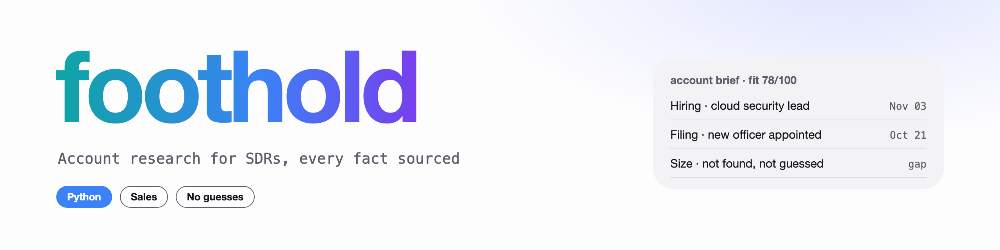
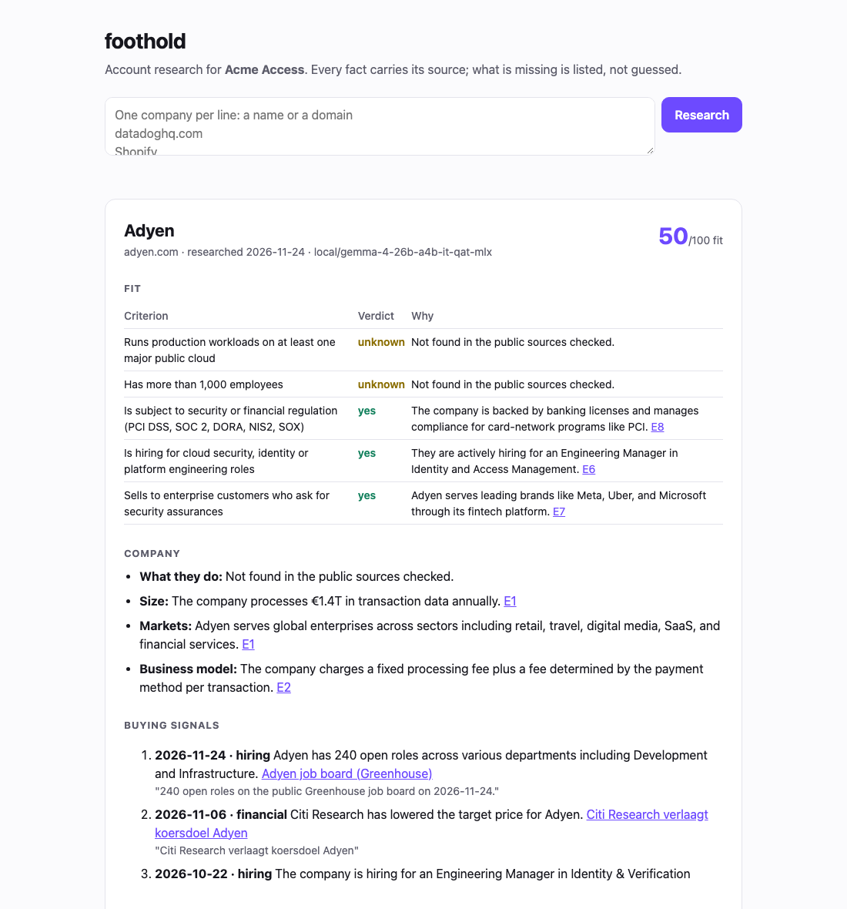
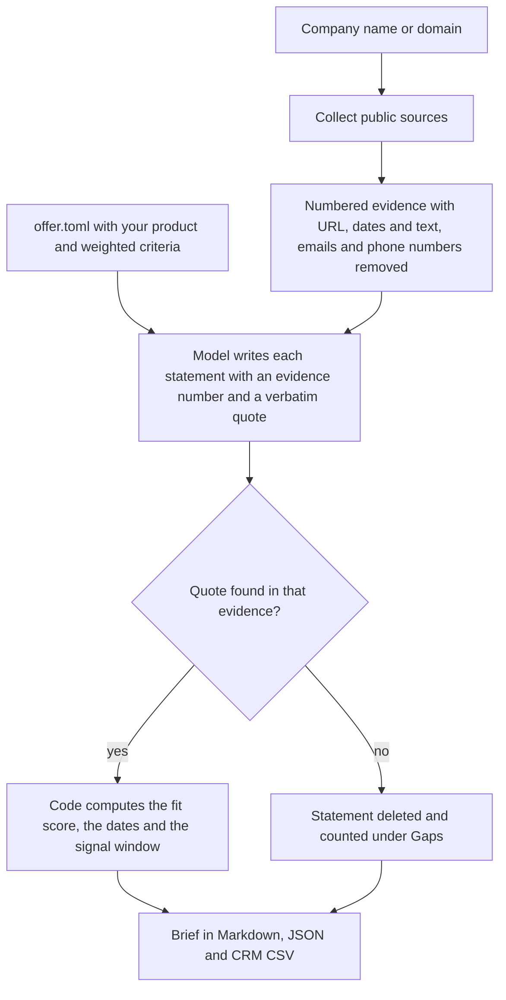

<picture>
  <source media="(prefers-color-scheme: dark)" srcset="docs/banner-dark.png">
  
</picture>

# foothold

[](https://github.com/Bouliw/foothold/actions/workflows/ci.yml)

foothold does the account research an SDR or BDR does before a first touch. Give it a
company and a file describing what you sell. It reads public sources and writes a brief:
what the company does, how well it fits your ideal customer and why, recent dated buying
signals, which job titles to approach, three openers that each cite one signal, and the
objections to expect.

Every fact in a brief carries a source link, a date and the exact passage it rests on.
A statement whose passage is not found word for word in the source is deleted before you
see it, and what could not be established is listed under **Gaps** instead of being
filled in.

<picture>
  <source media="(prefers-color-scheme: dark)" srcset="docs/screenshot-dark.png">
  
</picture>

## Install

Python 3.11 or later. foothold itself has no dependencies.

```sh
pip install git+https://github.com/Bouliw/foothold            # local or OpenAI-compatible models
pip install "foothold[claude] @ git+https://github.com/Bouliw/foothold"   # adds the Claude API
```

## Use

Copy [`examples/offer.toml`](examples/offer.toml) to `offer.toml` and describe your
product, your ideal customer as weighted yes/no criteria, the problems you solve and
your competitors. Then:

```sh
foothold research datadoghq.com          # one account, by domain or by name
foothold batch accounts.csv              # a list: CSV with a name or domain column, or one company per line
foothold serve                           # a local web page at http://127.0.0.1:8765
```

Each account gets a Markdown and a JSON file named after its domain
(`briefs/datadoghq-com.md`, `briefs/datadoghq-com.json`), and each `research` or `batch` run writes
`briefs/accounts-hubspot.csv`, ready for a company import (`--crm salesforce` switches
the column names to Account Name / Website). The other columns (fit score, top signal,
openers, gaps) map to custom properties you create once in the CRM.

A domain is the most reliable input. A bare name is resolved through Wikidata, only to
an entry that carries that exact name, looks like a company and lists an official
website; otherwise foothold stops and asks for the domain.

## Choosing the model

| Provider | Setup |
|---|---|
| Claude API | `ANTHROPIC_API_KEY`, and the `claude` extra |
| Local (LM Studio, Ollama, llama.cpp) | nothing: `http://localhost:1234/v1` and the loaded model by default; `--base-url http://localhost:11434/v1` for Ollama |
| Any OpenAI-compatible API | `OPENAI_API_KEY` and `--model`, plus `--base-url` for another host |

Without `--provider`, foothold uses the Claude API if `ANTHROPIC_API_KEY` is set, then
the OpenAI API if `OPENAI_API_KEY` is set, then a local server. It prints the provider,
model and address it is about to use. `--provider`, `--model` and `--base-url` (or
`FOOTHOLD_PROVIDER`, `FOOTHOLD_MODEL`, `FOOTHOLD_BASE_URL`) override this, and an
address given without a provider is treated as an OpenAI-compatible server, so an
Anthropic key is never sent to it.

Variables can live in a `.env` file in the folder you run foothold from. A `.env` that
sets the address while the key comes from your own environment is refused: a folder
someone shared with you cannot redirect your key. With a local model nothing leaves your
machine except the requests to the public sources below.

## Sources

Free public sources by default. Company pages are fetched only if the site's
`robots.txt` allows it, at the pace it asks for (capped at 10 seconds between requests),
and every answer is cached for 24 hours. Documented
public APIs are called under their own terms.

| Source | What it gives | Needs |
|---|---|---|
| Company website (home, about, pricing, customers, careers, press, security, blog) | Activity, markets, business model | |
| Front-end technologies in the page HTML and headers | Visible stack (marketing and web tools, not the internal one) | |
| Greenhouse, Lever, Ashby job board APIs; Workday career sites | Open roles with posting dates, postings matching your keywords | |
| Site news feed, GDELT, then Bing News RSS as a fallback | Dated headlines naming the company | |
| Wikidata | Official website, industry, country, founding year, headcount, stock listing | |
| SEC EDGAR | Revenue, dated 8-K events by item (results, acquisitions, officer changes) | `FOOTHOLD_CONTACT`, the contact address the SEC asks for |
| recherche-entreprises.api.gouv.fr | French register: creation date, activity code, size band | |
| Apollo | Company fields only (industry, headcount, revenue, funding) | `APOLLO_API_KEY` |
| Bright Data Web Unlocker | Second try for a company page that answers 403 | `BRIGHTDATA_API_KEY`, `BRIGHTDATA_ZONE` |

The Bright Data option is off unless you set both variables. It gets past bot protection
on pages that `robots.txt` allows, and never retries a "slow down" answer (429, 503).
Whether that suits a given site's terms is your call.

## No personal data

foothold researches companies, not people. It suggests job titles to approach and never
looks anyone up. It does not collect or guess email addresses or phone numbers, and
strips any that appear in a page before the text is stored or sent to the model. The
model is told to report a change of executive by role, not by name. Directors listed in
public registers are ignored, sole traders (registered under a person's name) are
skipped, and the Apollo integration reads company fields only.

One thing it does not do: rewrite news headlines. A headline that names a public figure
appears as published, with its link, in the list of sources.

## How it works



Collection and checking are plain code; the model only reads the evidence and proposes
statements. A broken model answer gets one second try, then the account is reported as
failed and the batch moves on.

## How a brief is checked

The model never gets the last word on a fact.

1. Every collected page becomes a numbered piece of evidence with its URL and dates.
2. The model must attach an evidence number and a verbatim quote to each statement.
3. Code looks for that quote in that evidence. No match, no statement.
4. The fit score is computed by code from the criteria verdicts and your weights. A
   criterion nobody could check counts as not met and is shown as `unknown`.
5. Signal dates come from the source, not from the model, and dated signals older than
   `signal_window_days` are left out. A source with no date (a company page, the visible
   stack) gives an undated signal, shown as such.
6. An opener is kept only if it rests on a signal that survived these checks.

Web pages are untrusted input. Text hidden with HTML attributes or inline styles is
dropped before the model reads the page, a page cannot open or close an evidence block, a verdict without a
matching quote is discarded, and links are removed from everything the model writes
freely (openers, reasons, objections). What the checks cannot do is judge meaning: the
quote proves the passage is in the source, not that it supports the verdict. A page that
lies about its company, or a weak model that cites an irrelevant passage, still gets
through, which is why every verdict shows its quote.

## Example

[`examples/briefs`](examples/briefs) holds the output of
`foothold batch examples/accounts.csv --offer examples/offer.toml` for a fictional
access-security vendor against three public companies, run on 2026-11-25 with a
26B-parameter open model (Gemma) on a laptop, without the optional keys:

| Account | Fit | Signals | Brief |
|---|---|---|---|
| Datadog | 100/100 | 6 | [datadoghq-com.md](examples/briefs/datadoghq-com.md) |
| Adyen | 50/100 | 7 | [adyen-com.md](examples/briefs/adyen-com.md) |
| Shopify | 50/100 | 3 | [shopify-com.md](examples/briefs/shopify-com.md) |

The middling scores are the tool working as intended. Nothing public says which cloud
Adyen or Shopify run on, no source gives Adyen's headcount, and the model quoted no
passage that places Shopify under a regulation, so those criteria stay `unknown` and
count as not met. A local model also varies from one run to the next: the Gaps section
of each brief says how many of its statements failed the quote check.

## Limits

- The local web page listens on 127.0.0.1 only and checks a token on every action, but
  any program running under your account can read that token. Do not run `serve` on a
  shared machine.
- The quote check proves the passage exists in the source. The sentence summarising it
  is still written by a model: read the quote before you send anything.
- A small local model finds fewer facts and words them less well than a large one. The
  checks are the same for both.
- Sites that render everything in JavaScript or forbid crawlers yield little. That shows
  up as gaps.
- News matching is by company name in the headline, so a company named after a common
  word collects noise.
- SEC data covers companies that file with the SEC; the register lookup covers France.
- Openers are drafts for a person to edit, not messages to send in bulk.

## Development

```sh
pip install -e ".[test]" ruff
pytest
ruff check .
```

The tests run without network access.

## License

MIT
